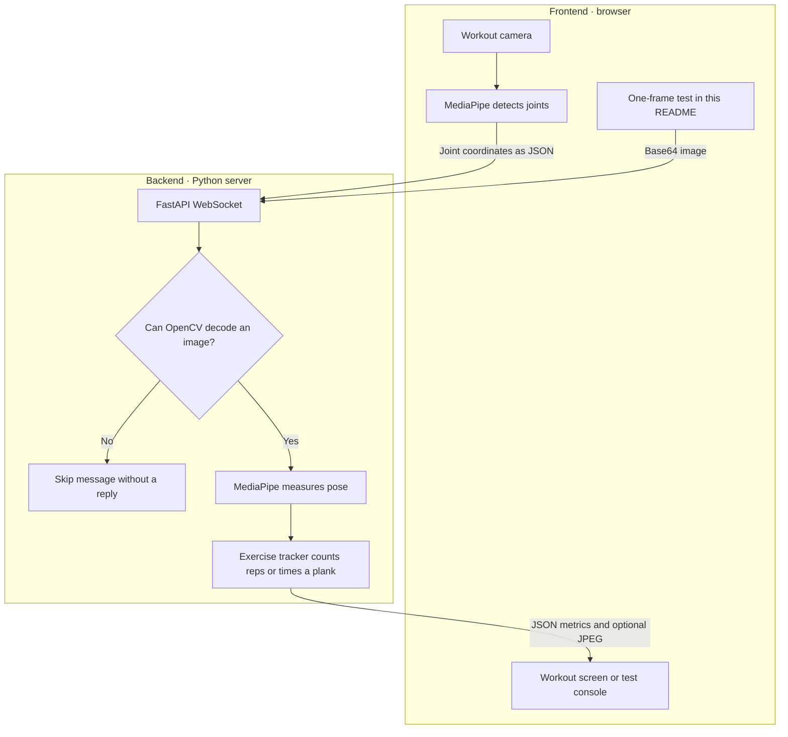

# ARAISE workout backend

This FastAPI service turns a stream of workout images into rep counts, plank hold time, and form feedback. A client selects an exercise in the WebSocket URL and sends one image at a time. For each processed frame, the server returns the joint angle, movement stage, a coaching cue, and an annotated image when available.

The [ARAISE web app](https://github.com/Ruthwik000/Arasie) provides the workout interface. Meal-photo analysis runs in the separate [food backend](https://github.com/Ruthwik000/food_araise).

## Architecture



**Frontend (browser).** The React workout screen opens the camera for the selected exercise. `PoseAnalyzer.jsx` uses MediaPipe to locate joints in each frame, and `websocket.js` sends their coordinates to `/ws/{exercise}`. When the screen receives a result, it displays the count, angle, stage, and feedback. It can also read the feedback aloud.

**Backend (Python server).** FastAPI accepts the connection and OpenCV decodes each base64 image. The selected tracker calls MediaPipe on that image, checks that all three required right-side joints have visibility of at least 0.7, and averages up to five valid joint angles. It uses that angle to count a rep or update the plank timer. The server sends the result back over the same socket. See [main.py](./main.py) and [excersises.py](./excersises.py).

**Why the two browser paths differ.** The current React client sends joint coordinates as JSON. The backend expects a base64 image, so it skips those messages and the workout screen receives no server feedback from them. The [one-frame test](#try-one-frame) sends an image in the accepted format and prints the server's reply.

## What each exercise measures

Use one of the four paths below. The server accepts connections for other exercise names but skips their frames without replying.

| WebSocket path | Joint | When the result changes |
| --- | --- | --- |
| `/ws/biceps` | Right elbow | Extending past 140° sets the stage to `down`. Curling below 50° then counts one rep and sets it to `up`. |
| `/ws/squats` | Right knee | Standing past 160° sets the stage to `up`. Lowering below 70° then counts one squat. |
| `/ws/pushups` | Right elbow | Straightening past 160° sets the stage to `up`. Lowering below 70° then counts one push-up. |
| `/ws/plank` | Right hip | A smoothed angle of at least 160° starts or resumes the hold. Moving out of range or losing the pose pauses timing. The result accumulates across holds. |

For the three rep exercises, the starting stage must be reached again before another rep can count. For a plank, `reps` contains accumulated whole seconds. When the required joints are missing or poorly visible, the response reports an angle of zero and the cue `Position yourself in frame`.

## Run locally

Use Python 3.11. From the repository root on Windows, run:

```powershell
py -3.11 -m venv .venv
.\.venv\Scripts\python.exe -m pip install -r requirements.txt
.\.venv\Scripts\python.exe main.py
```

Open `http://127.0.0.1:8000/`. The health check returns `{"message":"Server running"}`. Set `PORT` to change the default port of 8000. The repository also includes the [Render deployment configuration](./render.yaml).

## Try one frame

With the server running, open the health-check page and paste this into the browser console. It creates a blank image and sends it as a WebSocket text message, so the example works without camera permission.

```javascript
const frame = document.createElement("canvas");
frame.width = 320;
frame.height = 240;
const socket = new WebSocket("ws://127.0.0.1:8000/ws/squats");
socket.onopen = () => socket.send(frame.toDataURL("image/jpeg"));
socket.onmessage = ({ data }) => {
  const { processed_frame, ...metrics } = JSON.parse(data);
  console.log(metrics);
  socket.close();
};
```

On a fresh server, the expected metrics for that blank frame are:

```json
{"exercise":"squats","reps":0,"feedback":"Position yourself in frame","angle":0,"stage":"ready"}
```

For live tracking, draw the current video frame onto the canvas before sending it and keep the socket open across frames. The server accepts raw base64 text or an image data URL. The optional `processed_frame` response field contains base64 JPEG data. Prefix it with `data:image/jpeg;base64,` to display it in an image element.

## Session state

Each server process creates one detector and one tracker per exercise. Clients using the same exercise share its counter, stage, and angle history. Reconnecting to the same process keeps that state. Restarting the process clears it. The handler does not use the frontend's `user_id` query parameter to isolate workouts.
